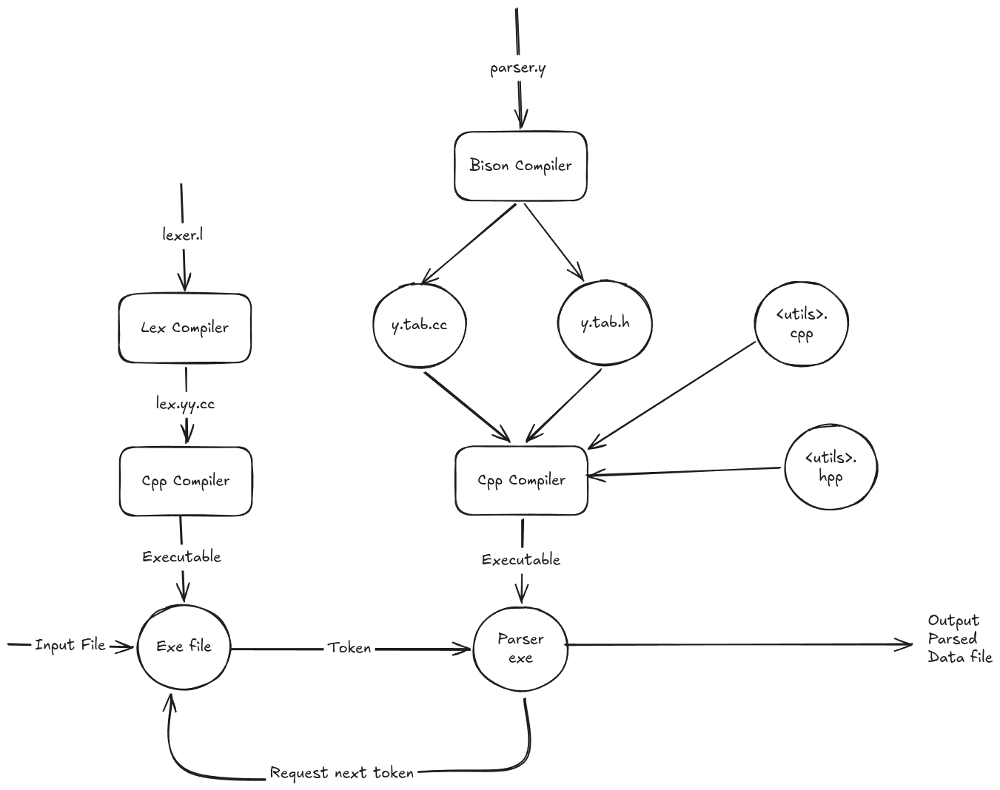

# MiniMIPS Assembler

This is the Flex/Bison assembler for MiniMIPS. It converts MiniMIPS assembly
source into one 32-bit hexadecimal instruction per line.

## Build

From this directory:

```sh
make
```

The executable is created at:

```text
build/minimips-as
```

From the repository root, the same build is included in:

```sh
make preset
```

## Use

```sh
build/minimips-as input.s -o output.hex
```

For example:

```sh
build/minimips-as ../sw/asm/smoke.s -o ../sw/hex/smoke.hex
```

The generated file can be passed to the SoC testbench:

```sh
cd ..
make run-soc_tb HEX=sw/hex/smoke.hex
```

## Source Format

Registers are named `R0` through `R15`. The assembler supports the MiniMIPS
ALU, immediate, load/store, branch, multiply, and halt instructions.

```asm
addi R1, R0, 3
addi R2, R0, 7
add  R3, R1, R2
halt
```

It also supports labels, memory operands, and `.word` values:

```asm
start:
    ld   R1, 0(R0)
    addi R1, R1, 1
    st   R1, 0(R0)
    b    start

value:
    .word 42
```

Comments can start with `;`, `#`, or `//`. Integer literals may be decimal,
hexadecimal (`0x...`), or binary (`0b...`).

## Output

The output is suitable for Verilog `$readmemh`: one uppercase 32-bit word per
line. The `halt` instruction is emitted as `FC000000`.

The instruction encoding and memory layout are documented in
[`../docs/memory_map.md`](../docs/memory_map.md).

## Tests

Build and run the smoke comparison:

```sh
make test
```

Test a label manually:

```sh
make run INPUT=tests/labels.s OUTPUT=build/labels.hex
cat build/labels.hex
```

## Architecture

### Data Pipeline


